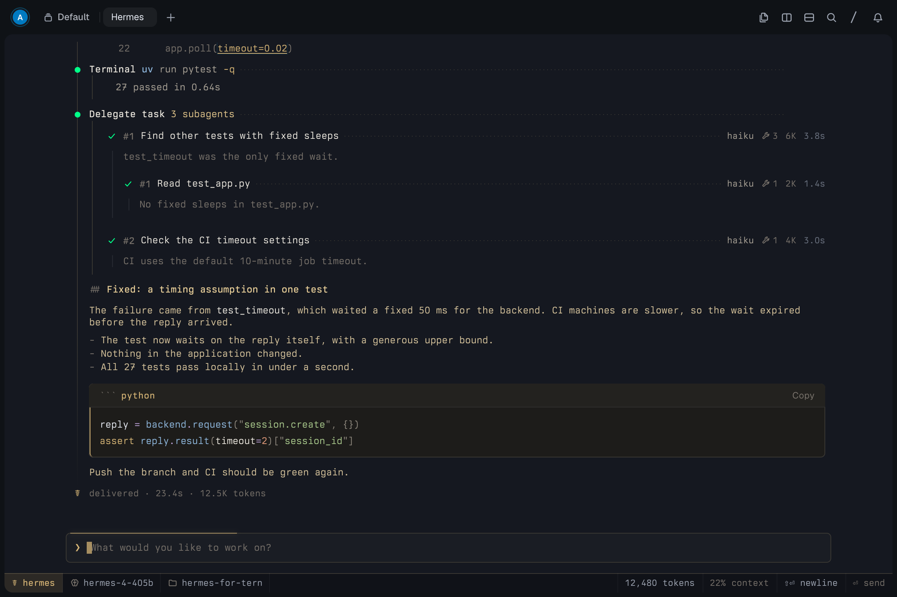

# Hermes for Tern

**Your agent, at home in Tern.**

A native [Tern](https://stencil.so/) frontend for [Hermes Agent](https://github.com/NousResearch/hermes-agent).
Type **`hermes`**, just as you normally would. Inside Tern, your conversation is rendered as
native Markdown, tool rows, subagents, buttons and a docked composer. In other terminals, the original
Hermes interface starts normally.

Hermes owns the agent. Tern owns the drawing. This adapter connects their existing protocols;
it does not patch Hermes, scrape ANSI output or embed a web chat.

> An unofficial community frontend. It is not affiliated with or endorsed by Nous Research,
> the makers of Hermes Agent, or by Stencil, the makers of Tern.

## Install

Prerequisites:

- macOS or Linux, Python 3.11+, Git and [uv](https://docs.astral.sh/uv/).
- Tern with Surface Protocol v1, `dock`, and the native component vocabulary.
- A working Hermes Agent installation and model configuration.

From this repository:

```sh
git clone https://github.com/thefullctx/hermes-for-tern.git
cd hermes-for-tern
uv sync --frozen
uv run hermes-for-tern --doctor
uv run hermes-for-tern --install
```

Then open Tern in your project and run:

```sh
hermes
```

The installer saves your existing launcher beside it as `hermes.before-tern` and installs
a small wrapper. It never modifies the Hermes repository, dependencies, credentials or
approval configuration. Keep this checkout and its `.venv` in place while the wrapper is installed.

To try it without installing the wrapper, run `uv run hermes-for-tern` inside Tern.

## Preview



[Animated session](assets/demo.gif). These previews were rendered by Tern itself, not mocked up in
a browser: a scripted turn (streaming, a failing test run, subagents and a fix) is played through
the real state and views, frame by frame, and replayed into a headless Tern. The events are
illustrative, so no model was called. The account avatar is Tern's headless test identity.

To re-record the scenes and render every preview image (needs Tern and ffmpeg):

```sh
./scripts/render_previews.sh
```

### Try the demo

Inside Tern, run `uv run hermes-for-tern --demo 30` for a labelled simulation. It makes no model
requests, runs no tools, and changes no project files.

The [visual design and motion notes](docs/design.md) describe the interface and its previews.

### Backend compatibility

The default backend command uses Hermes's managed launcher:

```text
<original-hermes> --run-module tui_gateway.entry
```

For a conventional Hermes virtualenv installation without `--run-module`, specify its backend:

```sh
uv run hermes-for-tern --install --backend '/absolute/path/to/hermes-venv/bin/python -u -m tui_gateway.entry'
```

That interpreter must have Hermes's dependencies and its modules must be importable from your
project directory. For example, install Hermes into its own virtualenv as an editable package.
Do not install Tern dependencies into Hermes's managed environment.

`--target /path/to/bin/hermes` can instead create a wrapper in a different directory placed
earlier in `PATH`, preserving the existing launcher at its original location.

## Core features

- Streamed Markdown, highlighted code, tool output, and live subagent controls.
- Native approvals, clarification questions, and masked secret input.
- Model selection, Hermes commands and skills, session names, resume and switching.
- Up to eight queued follow-ups, with explicit pause/continue after Stop or failure.
- Reconnect and resume after a backend crash, without automatically replaying work.
- Private recovery of unsent ordinary drafts and queues across frontend restarts.
- Search across loaded history and export to Markdown.

See the [full feature reference](docs/features.md) for details.

## Recovering work

On a disconnect, choose **Reconnect and resume** or type `/reconnect`. Your draft and queue stay
available. Previously submitted work may already have changed files; it is never automatically
resent. If resume fails, retry or explicitly choose **Start new session**. Queued messages remain
paused until you choose **Continue queue** (`/queue-continue`); **Discard queue** (`/queue-discard`)
removes only queued messages.

After a frontend restart, **Restore saved text** (`/recover`) opens the saved text's own session,
restores its draft and queue, and sends nothing. Clear your current draft and queue first. Saved
text is isolated by project, profile and session under
`$XDG_STATE_HOME/hermes-for-tern` (default `~/.local/state/hermes-for-tern`), in private files.
Ordinary text is saved at most twice a second, with immediate saves on submission and normal exit;
a sudden kill can lose the most recent half-second of typing. Secret and clarification answers
are excluded. **Discard saved text** deletes an offered recovery record.

Use `/find <text>`, `/find-next`, `/find-previous`, and `/find-close` to search loaded history.
Use `/export /path/to/conversation.md` to save it as Markdown. Export includes available full tool
output; cleared/unloaded history and output Hermes did not store cannot be reconstructed.

## Keys

| Key | Action |
| --- | --- |
| Enter | Send a prompt, answer a clarification, allow once on a pending approval, or switch model with the sheet open |
| 1–9 | Pick the choice shown on an approval or clarification card |
| Shift+Enter / Alt+Enter | Insert a newline |
| Ctrl+C | Stop an active turn, or clear the draft; a second Ctrl+C within two seconds exits, so a stray press never does |
| Escape | Stop the active turn; deny a pending approval; put the model sheet away |
| Ctrl+D with an empty draft | Exit |
| `/` on an empty draft | Opens the command list; keep typing to narrow it, ↑/↓ to move, Tab to complete, Enter to run, Escape to close |
| With the model sheet open | Type to filter, ↑/↓ to move the cursor, Enter to switch, Escape to close |
| While watching a subagent | Type a line to steer it, Enter to send, Escape to stop watching |
| Native selection / undo shortcuts | Handled through Tern's edit and undo events |

The composer stays editable while Hermes works: `Enter` holds your message and sends it the moment
the turn ends, rather than discarding it. Digits only pick a clarification option while the answer box
is still empty, so typing a number into a free-text answer types a number.

`/model`, `/btw`, `/bg`, `/name` (also `/title`), `/resume` (also `/sessions`), `/cost`, `/doctor`, `/clear`, `/stop`, `/help` and
`/quit` (also `/exit`) are answered in the pane; every other slash command goes to Hermes, which runs
it or says it does not know it. Nothing typed after a `/` is sent to the model as a message.

## Restore the original command

```sh
uv run hermes-for-tern --uninstall
```

To temporarily use the original interface even inside Tern:

```sh
hermes --plain
```

`TERN_TSP=0 hermes` also disables surface detection. Before moving/removing this checkout or
updating an installation that replaces its outer `hermes` launcher, uninstall the wrapper.
The uninstaller refuses to overwrite a launcher that somebody changed after installation.

## Architecture

```text
Tern pane ⇄ Surface Protocol ⇄ Python adapter ⇄ JSON-RPC pipes ⇄ Hermes tui_gateway
```

- `launcher.py`: reversible installation, surface detection and original-command fallback.
- `rpc.py`: bidirectional transport, request matching and backend lifecycle.
- `state.py`: ordered transcript and pending-request state.
- `editor.py`: composer text/caret state and UTF-16 edit translation.
- `views.py`: semantic native components: turns, tools, subagents, questions and the dock.
- `design.py` and `design/`: packaged artwork, the palette with code colors, styles and motion.
- `demo_backend.py`: isolated simulation using the same JSON-RPC event path.
- `app.py`: UI event loop, streaming updates, approvals, clarification, interruption and reconnect.
- `recovery.py`: private, atomic storage of unsent ordinary drafts and queues.
- `diagnostics.py`: bounded startup and capability checks without an agent session.
- `transcript.py`: search and Markdown export of loaded conversation data.

The UI polls Tern input continuously while a background reader queues Hermes events.
Render updates are batched at roughly 30 Hz; the SDK handles diffing, credits and terminal cleanup.
The backend runs in a separate process with private pipes. Its stdout never reaches the pane directly.

## MVP boundaries

One live conversation per pane at a time. Recovery uses Hermes’s stored session and locally saved
ordinary drafts; it cannot reconstruct work Hermes did not store. Attachments, voice and desktop
browser bridges are not implemented. A session that runs for hundreds of turns
draws its newest 60 and says how many are left out (`… N earlier turns`), so a pane stays responsive
however long Hermes works; the transcript itself is not trimmed, and `/clear` still empties it. Hermes's other session commands
(`/new`, `/branch`, …) are not offered, since the pane follows one session at a time; `/resume` is
this pane's own.
Subagents show their goal, status, current tool and totals, nested by parent; click one to watch its
live transcript, steer it a line or interrupt it. The visual demo shows
sequential work phases, not subagents.
Unsupported Hermes launch flags fall back to the original interface rather than being silently discarded.
Hermes's one-string asks (`sudo`, `secret`, `vault.unlock_prompt`, `vault.code`) are answered in the
composer, masked; the answer is sent and kept nowhere. Other server requests — `tour`, `preview.act`,
`preview.read`, `terminal.read`, `window.read`, `vault.save_login` and the desktop bridges — receive an
explicit unsupported-method error so they cannot leave the agent waiting indefinitely.

The status strip gives up its least useful segments first when a pane is narrow: the newline hint
goes before the token count, the counts before the model name, and never the send or stop key.

Tern's inline surface disappears when you return to the shell prompt. Hermes owns durable conversation
storage; the Tern transcript is not a persistence layer. Multiplexers such as tmux disable SDK detection.
Long tool output is visually truncated at 48,000 characters in this MVP; the row states how many
characters it left out.

## Validation

The automated suite covers message ordering, Unicode editing, approvals, session routing, queue
limits and pausing, reconnect/resume, saved drafts, search/export, bounded diagnostics, hung pipes,
launcher restoration, and the isolated demo.

```sh
uv run pytest -q
uv run ruff check src tests scripts
uv run ruff format --check src tests scripts
```

CI runs macOS and Linux with Python 3.11, 3.13 and 3.14. The
[release checklist and validation record](docs/release-checklist.md) distinguish controlled backend
checks from live Hermes checks and list remaining validation limits.

## Contributing

Bug reports, ideas and pull requests are welcome; every change is reviewed before it is merged.
See [CONTRIBUTING.md](CONTRIBUTING.md) for setup, checks and the interface's house rules, and
[CODE_OF_CONDUCT.md](CODE_OF_CONDUCT.md).

## License and attribution

MIT. This is an independent integration, not an official Nous Research or Stencil product.
The composer was adapted from Stencil's MIT-licensed Python chat example, and the startup artwork
from Hermes Agent; see `THIRD_PARTY_NOTICES.md`.
