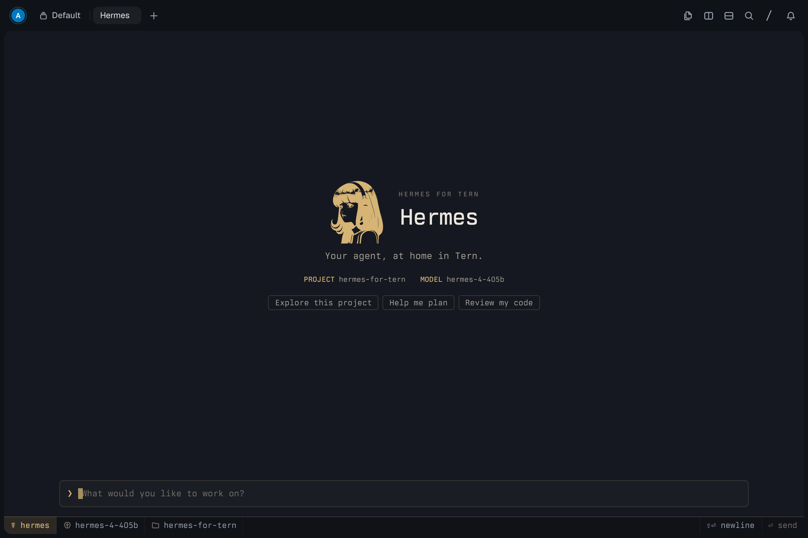

# Visual design and motion


Hermes follows the console idiom of Tern's Console chat style, whatever chat style you use:
one monospace face on the pane's cell grid and a three-cell gutter that carries the glyphs
(`❯` you, `●` a tool tinted by its status, `✗` an error). Tools have no frame: a title, its
target and a dotted leader to the time, with output behind a one-pixel guide and `└─` for
folded lines. Color is the only hierarchy, and Hermes's color is muted gold, on graphite in dark
mode and warm ivory in light mode. Your words are matte gold and Hermes's replies matte silver,
so who is speaking reads at a glance. The composer is one prompt line in a hairline box, above a
flat status strip with the model, project, usage and the send or stop key.

The startup screen is centered above the composer, with a staged logo/title/details entrance:
the HERMES wordmark writes itself in, stroke by stroke in gold over its own faint outline, beside
artwork adapted from Hermes Agent, project/model details, and three prompt suggestions.
While Hermes works, a single line above the composer names what it is doing and for how long;
when Hermes thinks in silence for a few seconds, its spinner gives way to the pen writing the H of
the wordmark, again and again.
Styling is scoped to this surface, so the surrounding Tern interface follows your theme.



[Startup entrance animation](../assets/entrance.gif).

Code in replies is highlighted with Hermes's own palette, gold keywords beside sky-blue functions,
sage strings, coral numbers and teal types, in a raised well with a gold edge and language label.

### Continuous motion and visual demo

Every step of a turn moves. Your message lifts into the transcript, and replies and tools rise in.
Streamed text is released at an even pace however bursty the model's output, behind a gold block
caret, and is written in gold ink that dries: the newest words appear in gold and settle into the
text color within about half a second. A gold thread runs down the gutter through a turn's steps,
gold while Hermes works and resting as a hairline afterwards. A finished
turn closes with `☤ delivered · time · tokens · rate`, a line a gold front writes on before it dries, and
Hermes signs it with the wordmark's H, whose ink dries to faint when the next turn begins; turns
longer than a minute also release a few sparks from the `☤`. A running tool's `●` breathes and the dots of
its leader march toward its live timer; when it finishes, the `●` pops into its outcome color and
one ring spreads out, and a failure also shakes its line once. A gold streak sweeps the composer's
top edge while a turn runs. The wordmark, the signatures, the thread and every underline are drawn
with one pen: the same stroke and ease. These effects respect Reduce Motion and, apart from the
pen's strokes inside its images, pause in hidden panes.

`scripts/record_motion.py` writes the scenes behind the previews (`assets/startup.jsonl` and
`assets/session.jsonl`); replay one with `surface-play "assets/session.jsonl" paced` in a
`tern shot` scenario to check motion frame by frame.

For a five-minute simulation inside Tern:

```sh
hermes --demo
```

It starts automatically and is visibly labelled **SIMULATED DEMO**. It runs the same native frontend
with a deterministic backend: no model requests, shell commands, or file changes. Stop works normally.
For a shorter run, use `hermes --demo 30` (seconds). Ordinary `hermes` still uses the real Hermes backend.
Demo durations must be between 10 and 1,800 seconds. The demo requires Tern and does not fall back
to the real agent in another terminal.
